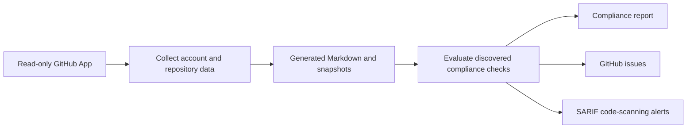

# 1. Overview

[Handbook](README.md) · [Next: Prerequisites and access](02-prerequisites-and-access.md)

This repository collects configuration from a GitHub Enterprise Cloud enterprise, a standalone
organization, or a personal account, renders it as Markdown, evaluates compliance requirements and
publishes findings. The workflow runs weekly and can also be started manually.

GitHub Governance is a community toolkit, not a compliance certification. Findings reflect the
configured checks and accessible GitHub data; missing data is reported as unavailable or not
evaluated rather than assumed compliant. See the [illustrative example](../example.md) and
[coverage notes](../repo/README.md#notes).

## What is configured where

| Path | Purpose |
| --- | --- |
| `.github/workflows/document-enterprise.yml` | Schedule, permissions and workflow steps |
| `src/GitHubGovernance/` | Data collection, rendering, compliance evaluation and publishing logic |
| `compliance/policy.json` | Central overrides and target-specific exemptions |
| `tests/<check-id>/check.json` | Check identity, scope, reporting text and live data source |
| `tests/<check-id>/policy.json` | Default enabled state, severity and parameters for one check |
| `tests/<check-id>/<check-id>.Tests.ps1` | Policy evaluator and its Pester assertion |
| `tests/<check-id>/issue.md` | Issue body template for a failed check |
| `docs/enterprise/` | Generated documentation, compliance report and raw data snapshots |

Only the content under `docs/enterprise/` is generated. Edit the source configuration, module,
check folders or handbook—not the generated pages, which are replaced on the next run.

## Two evaluation modes

`Test-GHCompliance` discovers compliance checks from manifests under `tests/`. By default, it
evaluates saved snapshots. With `-UsePester`, it evaluates the same policy logic against live GitHub
data using an active GitHub App connection. Both modes use each check's `-PolicyOnly` evaluator.

The local per-check policy supplies defaults. An entry for that check in `compliance/policy.json`
overrides those defaults. Exemptions are separate: they skip a particular check for a particular
enterprise, organization or repository.

## Continue

- [Prerequisites and access](02-prerequisites-and-access.md)
- [Repository guide](../repo/README.md)
- [Generated documentation layout](07-operations-and-troubleshooting.md#generated-documentation-layout)
